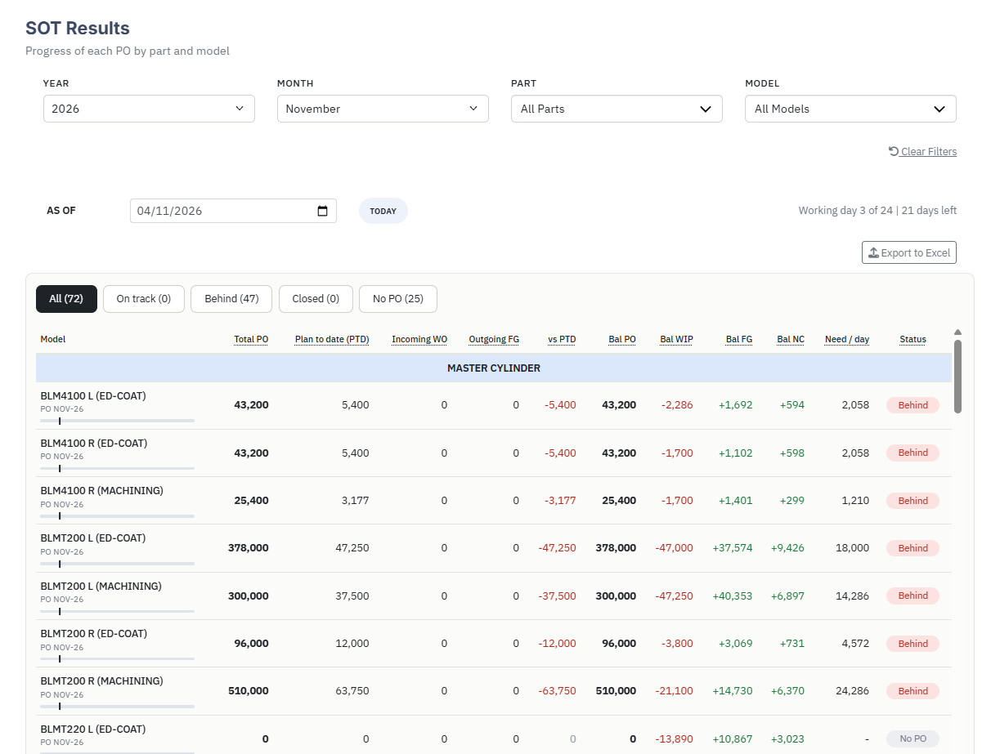
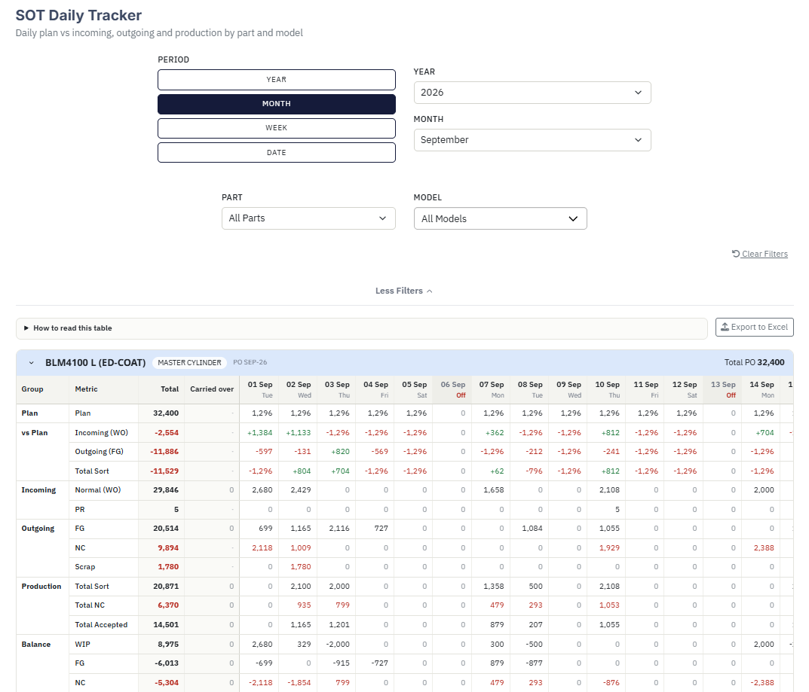
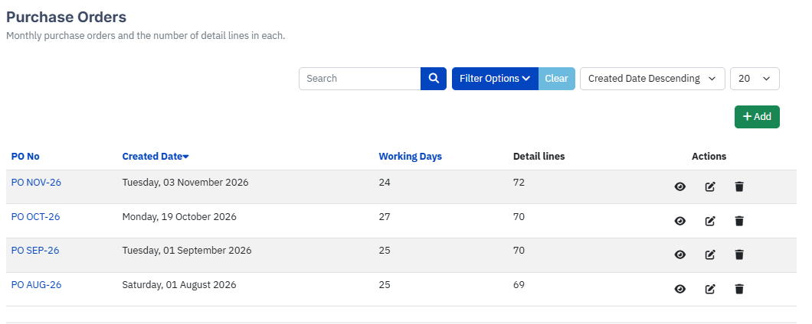
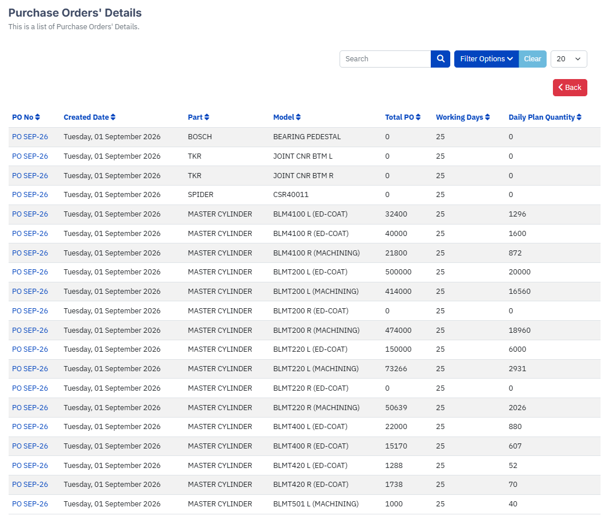

# Purchase Order Completion Tracking (SOT)

A Joomla 4/5 website for tracking how far each purchase order (PO) has progressed, from incoming material through production to finished goods shipped.

The **SOT** component (`com_sot`) is the core of the site. It adds two report pages, **SOT Results** (summary) and **SOT Daily Tracker**, on top of the purchase order, incoming, outgoing and production data kept by the other extensions in this repository.

---

## Contents

- [Screenshots](#screenshots)
- [What it does](#what-it-does)
- [Repository layout](#repository-layout)
- [Requirements](#requirements)
- [Installation](#installation)
- [Menu items](#menu-items)
- [How the numbers are calculated](#how-the-numbers-are-calculated)
- [Data sources](#data-sources)
- [Configuration and maintenance](#configuration-and-maintenance)
- [Export to Excel](#export-to-excel)
- [Development notes](#development-notes)

---

## Screenshots

| SOT Results | SOT Daily Tracker |
|---|---|
|  |  |

---

## What it does

### SOT Results (summary)

One row per **model**, grouped by **part**, for a chosen month. Figures are cumulative from the 1st of the month up to an **As of** date (today by default, editable to any date).

| Column | Meaning |
|---|---|
| Total PO | Quantity ordered on the PO |
| Plan to date (PTD) | Planned quantity from the first working day up to the As of date |
| Incoming WO | Normal incoming (WO) received, plus carried over |
| Outgoing FG | Finished goods shipped, plus carried over |
| vs PTD | Outgoing FG - Plan to date |
| Bal PO | Total PO - Outgoing FG (never below 0) |
| Bal WIP | Incoming WO - Total sort |
| Bal FG | Total accepted - Outgoing FG |
| Bal NC | Total NC - (Outgoing NC + Scrap) |
| Need / day | Bal PO / working days left |
| Status | Behind, On track, Closed or No PO |

Features: Year, Month, Part and Model filters, status tabs (All / On track / Behind / Closed / No PO), a progress bar per model with a marker for the plan, a click-through from each model to its Daily Tracker, a column-header tooltip showing each formula, and an Excel export.

### SOT Daily Tracker

One card per model, with one column per day (or per month for the Year period) and a **Total** and **Carried over** column in front.

| Group | Rows |
|---|---|
| Plan | Plan |
| vs Plan | Incoming (WO), Outgoing (FG), Total Sort, each compared with the plan up to today |
| Incoming | Normal (WO), PR |
| Outgoing | FG, NC, Scrap |
| Production | Total Sort, Total NC, Total Accepted |
| Balance | WIP, FG, NC |

Features: Period selector (Year / Month / Week / Date) with year, month and week pickers, sticky Group / Metric / Total columns while scrolling across days, Sundays and holidays shaded as Off, collapsible cards, filters for Part and Model, hover/tap tooltips with formulas, and an Excel export.

### Purchase Order Entry

Front-end form to create a PO (PO number, year, month, working days) with detail lines (part, model, total PO, daily plan quantity). A model can only be used once per PO. 

| Purchase Orders | Purchase Order's Details |
|---|---|
|   |   |

---
 
## Repository layout

```
purchase-order-completion-tracking/
├── applications/                 Installable Joomla packages (zip)
│   ├── com_sot-1.0.4.zip         SOT component (this README)
│   ├── com_calendar-1.0.0.zip    Working calendar and holidays
│   ├── com_product-3.0.0.zip     Part / model catalogue
│   ├── com_production-3.0.2.zip  Production summary
│   ├── plg_ajax_export-2.0.0.zip Excel export (also used by SOT)
│   ├── plg_ajax_importorders_package.zip
│   ├── plg_ajax_updatepartmodel.zip
│   └── plg_task_datasync.zip
├── screenshots/                 
│   ├── 01-sot-results.pngp       
│   ├── 02-sot-daily-tracker.png
│   ├── 03-purchase-orders.png
│   ├── 04-purchase-orders-details.png
│   ├── 05-incoming-orders.png
│   ├── 06-outgoing-orders.png
│   ├── 07-production-summary.png
│   └── 08-production-list.png
└── README.md
```

---

## Requirements

- Joomla 4.x or 5.x
- PHP 8.0+ (8.1+ recommended)
- MySQL / MariaDB
- Joomla's built-in `choicesjs` asset (for the searchable dropdowns)
- The extensions that provide the data (see [Data sources](#data-sources))

---

## Installation

1. Install the supporting extensions you do not already have, from `applications/` (**System → Install → Extensions → Upload Package File**). Typical order: `com_product`, `com_calendar`, `com_production`, then the plugins.
2. Install `applications/com_sot-1.0.4.zip` the same way. Updating from an older version runs the SQL update scripts automatically.
3. Enable the plugins you need (**System → Manage → Plugins**), including `plg_ajax_export`.
4. Create the menu items (see below).
5. Open **SOT Results** and check that the part and model filters list your catalogue.

> Back up the database and the `components/com_sot`, `administrator/components/com_sot` and `media/com_sot` folders before updating.

---

## Menu items

| Menu item type | View |
|---|---|
| SOT Results | `index.php?option=com_sot&view=sotsummary` |
| SOT Daily Tracker | `index.php?option=com_sot&view=sotdaily` |
| Purchase | `index.php?option=com_sot&view=purchaseorders` |
| PO Details | `index.php?option=com_sot&view=purchaseorderdetails` |
| Incoming | `index.php?option=com_incoming&view=incomingorders` |
| Outgoing | `index.php?option=com_outgoing&view=outgoingorders` |
| Production | `index.php?option=com_production&view=productionreport` |
| Production List | `index.php?option=com_production&view=productionsummaries` |

Both reports are read-only and open to any user who can see the menu item, so set the menu item access level accordingly.

---

## How the numbers are calculated

### Working days and plan

- Sundays and rows in the calendar holiday table are non-working days. **Saturday is a working day.**
- A PO runs for its `working_days`, but never more than the working days that exist in that month.
- Daily plan = `ceil(Total PO / working days)` (or the daily plan quantity entered on the line), applied to the **first N working days**. The last day is trimmed so the plan always adds up to exactly Total PO.
- Plan to date = the plan up to and including the As of date.

### Status

| Status | Rule |
|---|---|
| No PO | Total PO is 0 or less |
| Closed | Outgoing FG ≥ Total PO |
| Behind | Outgoing FG < Plan to date |
| On track | Everything else |

### Balances

| Item | Formula |
|---|---|
| Total accepted | Total sort - Total NC |
| Bal WIP | Incoming WO - Total sort |
| Bal FG | Total accepted - Outgoing FG |
| Bal NC | Total NC - (Outgoing NC + Scrap) |
| Bal PO | max(0, Total PO - Outgoing FG) |
| Need / day | ceil(Bal PO / working days left) |

In the Daily Tracker the balances are per day (or month), with the carried-over amount in its own column. In the Summary they are cumulative up to the As of date.

### vs Plan (Daily Tracker)

Each value is the movement minus the plan for that day, computed against the plan up to today only. Future days are blank.

### Carried over

Quantities brought forward from the previous period. They are shown in their own column and included in the Total column and in the Summary.

| Metric | Source |
|---|---|
| Incoming Normal (WO) | Incoming orders with remark `7` |
| Outgoing FG | Outgoing orders with remark `4` |
| Total Sort, Total NC, Total Accepted | Production rows where `source = 'manual'` |

Manual production rows are not repeated in the daily columns.

---

## Data sources

All queries use records with `state = 1` only. The details table has no state of its own and follows its parent PO.

| Table | Used for |
|---|---|
| `#__sot_purchase_orders` | PO header: `po_no`, `year`, `month`, `working_days`, `state` |
| `#__sot_purchase_orders_details` | PO lines: part, model, `total_po`, `daily_plan_qty` (model may be stored as id or name) |
| `#__incoming_orders` | Incoming; remark 1 = WO, 2 = PR, 7 = carried over |
| `#__outgoing_orders` | Outgoing; remark 1 = Scrap, 2 = FG, 3 = NC, 4 = carried over |
| `#__production_summary` | `total_sort`, `total_nc`, `source` by date and model |
| `#__product_catalogs`, `#__product_components` | Parts and models |
| `#__calendar_holidays` | Holidays |

Remark values are constants in `site/src/Helper/SotReport.php` (`IN_WO`, `IN_PR`, `IN_CARRY`, `OUT_SCRAP`, `OUT_FG`, `OUT_NC`, `OUT_CARRY`). Change them there if the meaning of a remark changes.

---

## Configuration and maintenance

### Production variants (model mapping)

Production can report variants of a model (for example `JOINT CNR BTM L1`, `L2`, `L4`, `R1` ...) that purchase and incoming orders know as one model (`JOINT CNR BTM L`). Variants are added to their main model in both reports.

The mapping is a constant, `MODEL_MAP`, in `site/src/Helper/SotReportData.php` (variant id → main model id):

```php
private const MODEL_MAP = array(
    121 => array(122, 123, 124, 125, 126),
    127 => array(128, 129, 130, 131, 132),
);
```

It uses **ids**, not names, so renaming a model in the catalogue does not break it. Add a line whenever a new variant group appears.

### Adding a remark

A new remark (for example `AO`, Adjustment Order) is ignored by the reports until it is added to `SotReportData::movements()` and counted in the right row.

### Clearing old data

The reports read live data, so export before you delete old records. Use **Export to Excel** on both pages for the months you are about to clear.

---

## Export to Excel

Both pages have an **Export to Excel** button that calls the `plg_ajax_export` plugin through `com_ajax` and downloads an `.xlsx` file for the filters currently on screen.

- **SOT Results**: one row per model, one column per summary column.
- **SOT Daily Tracker**: one row per model per day (per month for the Year period), plus one *Carried over* line per model. It is a flat table, so it works with Excel filters and pivot tables. Filter or sum by date type so carried-over lines are not counted twice.

---

## Development notes

- Calculation rules live in `SotReport.php` and have no database or Joomla dependency, so they can be unit tested with plain PHP.
- Reports are built from `SotReportData` (queries) → `SotsummaryModel` / `SotdailyModel` (assembly) → templates.
- Styles are scoped under `.sot` in `media/css/report.css`; behaviour is in `media/js/report.js` (auto-submit, period presets, filters, tabs, row click, Choices dropdowns).
- Every user-facing string is a `COM_SOT_*` key in `site/languages/en-GB/com_sot.ini`.
- Never commit `configuration.php`, database dumps or credentials.
